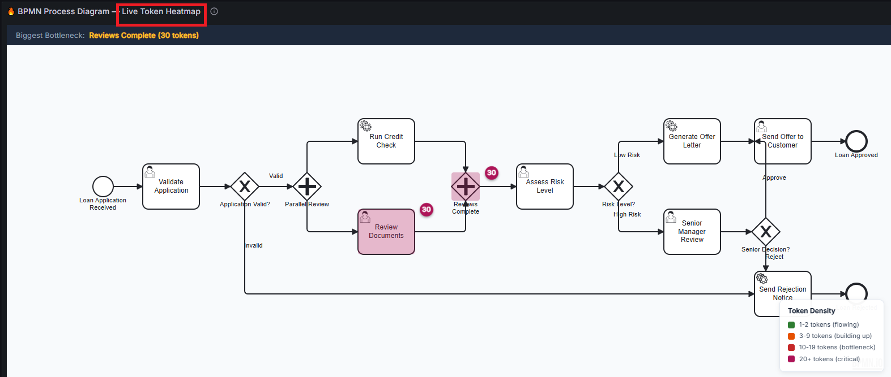
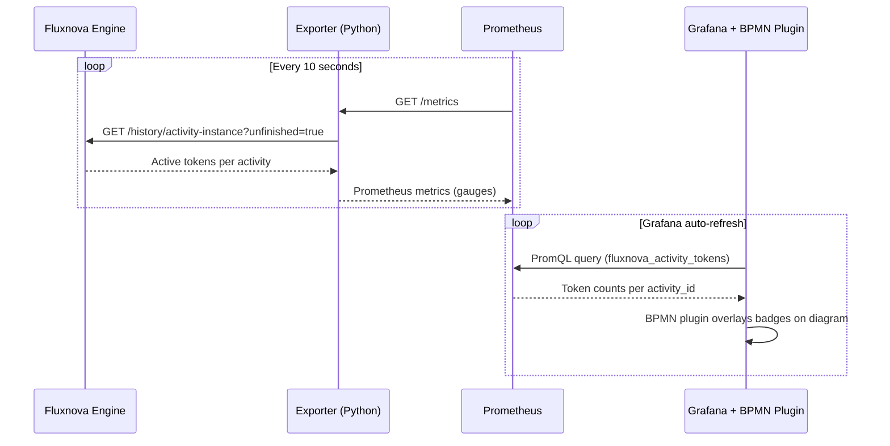
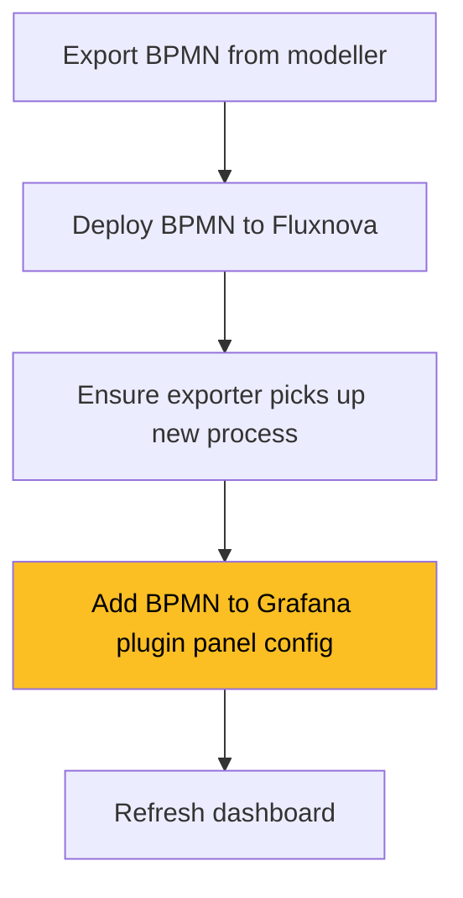

# Fluxnova BPM - Process Heatmap & Monitoring

A real-time BPMN process heatmap that visualises where tokens (active process instances) are accumulating across a Fluxnova BPM workflow. Identifies bottlenecks at a glance through a native Grafana panel plugin.

 

## What You'll See

The Grafana dashboard shows:
- A rendered BPMN diagram with colour-coded badges on each activity
- 🟢 Green (1–2 tokens) · 🟠 Orange (3–9) · 🔴 Red (10–19) · 🩷 Pink/pulsing (20+)
- The biggest bottleneck highlighted in the stats bar
- Supporting bar charts, time series, and gauges for token distribution



---

## Quick Start

### Prerequisites

| Requirement | Version | Check |
|-------------|---------|-------|
| [Podman](https://podman.io/getting-started/installation) or Docker | Any recent | `podman --version` |
| Python | 3.10+ | `python3 --version` |
| curl | Any | `curl --version` |

> **No Java, no Node.js, no build step required** — the BPM engine runs in a container and the Grafana plugin is pre-built.

### One Command Start (Linux / WSL)

```bash
cd scripts/bash
chmod +x *.sh
./start-all.sh
```

This takes ~30 seconds and:
1. Pulls and starts Fluxnova BPM engine
2. Builds and starts the Prometheus exporter
3. Starts Prometheus and Grafana (with the BPMN Heatmap plugin and dashboards)
4. Deploys the loan-approval BPMN process
5. Generates 25 sample process instances with varied task completion

**Dashboard:** http://localhost:3000/d/fluxnova-heatmap
**Login:** `admin` / `fluxnova`

To stop everything:

```bash
./stop-all.sh
```

### Windows (PowerShell)

```powershell
cd scripts/powershell

.\start-fluxnova.ps1          # Start BPM engine
# Wait ~20 seconds
.\start-monitoring.ps1         # Exporter + Prometheus + Grafana (with plugin)
.\generate-sample-data.ps1     # Deploy process + generate data

# Open http://localhost:3000/d/fluxnova-heatmap (admin / fluxnova)
```

---

## Architecture


The heatmap is rendered **natively inside Grafana** via a custom panel plugin — no iframes, no separate servers, no CORS issues.

### Data Flow



### Component Summary

| Component | Port | Technology | Role |
|-----------|------|-----------|------|
| Fluxnova BPM | 8080 | Java (container) | BPMN process runtime |
| Exporter | 9091 | Python (container) | Scrapes Fluxnova → Prometheus metrics |
| Prometheus | 9090 | Go (container) | Time series database |
| Grafana | 3000 | Go (container) | Dashboard UI with native BPMN heatmap plugin |

---

## The Grafana BPMN Heatmap Plugin

The plugin lives in `grafana-bpmn-heatmap-plugin/` and renders BPMN diagrams directly inside Grafana with live metric overlays. No iframe, no external server required.

### How It Works

- The plugin uses [bpmn-js](https://bpmn.io/toolkit/bpmn-js/) to render your BPMN diagram
- It reads query results from any Grafana datasource (Prometheus, InfluxDB, SQL, etc.)
- Badges and overlays are applied based on configurable thresholds
- Refreshes automatically with Grafana's built-in auto-refresh

### Rebuilding the Plugin

The plugin `dist/` is pre-committed so you don't need Node.js to run the example. If you need to modify the plugin source and rebuild:

```bash
cd grafana-bpmn-heatmap-plugin
npm install --legacy-peer-deps
npm run build
```

To commit the rebuilt output for others:

```bash
./build-and-commit.sh
git commit -m "chore: rebuild plugin"
git push
```

### Plugin Configuration

| Option | Default | Description |
|--------|---------|-------------|
| BPMN File URL | _(empty)_ | URL to fetch .bpmn XML file |
| BPMN XML (inline) | _(empty)_ | Paste BPMN XML directly (URL takes priority) |
| Activity ID Field | `activity_id` | Label/field mapping to BPMN element IDs |
| Value Field | `Value` | Field containing the token count |
| Show Count Badges | `true` | Show/hide count numbers on elements |
| Show Bottleneck Header | `true` | Show/hide the "Biggest Bottleneck" bar |

### Note on @grafana/ui Types

The plugin uses `useTheme2()` from `@grafana/ui` at runtime (Grafana provides it), but to keep
the dependency tree small, a minimal type stub is used instead of the full package. If you modify
theme-related code, the type will be `any`. For full type safety, add `@grafana/ui` back to
devDependencies — but be aware it pulls in 600+ transitive packages.

See [`grafana-bpmn-heatmap-plugin/README.md`](grafana-bpmn-heatmap-plugin/README.md) for full plugin documentation.

---

## Corporate / Air-gapped Environments

If you're behind a corporate proxy that blocks Docker Hub, set the `REGISTRY` environment variable:

```bash
REGISTRY=artifactory.yourcompany.com/docker-virtual ./start-all.sh
```

Or override individual images:

```bash
export FLUXNOVA_IMAGE=my-registry/finos/fluxnova-bpm-platform:latest
export PROMETHEUS_IMAGE=my-registry/prom/prometheus:v2.53.4
export GRAFANA_IMAGE=my-registry/grafana/grafana:10.4.2
./start-all.sh
```

### Environment Variables

| Variable | Default | Description |
|----------|---------|-------------|
| `REGISTRY` | `docker.io` | Container image registry prefix |
| `FLUXNOVA_IMAGE` | `$REGISTRY/finos/fluxnova-bpm-platform:latest` | Fluxnova engine image |
| `PROMETHEUS_IMAGE` | `$REGISTRY/prom/prometheus:latest` | Prometheus image |
| `GRAFANA_IMAGE` | `$REGISTRY/grafana/grafana:10.4.2` | Grafana image |

---

## Using a Different BPMN Process



**Steps:**
1. Export your BPMN from your modeller (Fluxnova Modeler, bpmn.io, etc.)
2. Deploy the BPMN to Fluxnova via the REST API or the scripts:
   ```bash
   ./scripts/bash/deploy-process.sh /path/to/your-process.bpmn
   ```
3. Place the `.bpmn` file in `grafana-bpmn-heatmap-plugin/dist/bpmn/` (so the plugin can serve it)
4. Update the Grafana panel configuration:
   - Edit the dashboard panel → set the BPMN File URL to `/public/plugins/fluxnova-bpmn-heatmap-panel/bpmn/your-process.bpmn`
   - Update the Prometheus query to match your process definition key:
     ```promql
     fluxnova_activity_tokens{process="your-process-key"}
     ```
5. Refresh the dashboard

> **Important:** BPMN element IDs must match between the deployed process and the `.bpmn` file used in the plugin. If you re-export from a different modeller, check that IDs haven't changed.

> **Tip:** Always use a visual BPMN editor (e.g. the Fluxnova Modeler or [bpmn.io](https://bpmn.io)) to adjust diagram layouts. Hand-editing waypoint coordinates in XML can result in broken or overlapping sequence flow arrows.

---

## Project Structure

```
├── scripts/
│   ├── bash/
│   │   ├── start-all.sh             ← One command to start everything
│   │   ├── stop-all.sh              ← One command to stop everything
│   │   ├── start-fluxnova.sh        ← Start BPM engine only
│   │   ├── start-monitoring.sh      ← Start Exporter + Prometheus + Grafana
│   │   ├── generate-sample-data.sh  ← Deploy process + create test instances
│   │   ├── deploy-process.sh        ← Deploy a BPMN file to Fluxnova
│   │   ├── start-process.sh         ← Start a single process instance
│   │   └── complete-task.sh         ← Complete a specific task
│   └── powershell/                   # Windows equivalents
│
├── grafana-bpmn-heatmap-plugin/      # ★ Native Grafana panel plugin
│   ├── src/                          # React + bpmn-js source
│   ├── dist/                         # Pre-built plugin (ready to use)
│   │   ├── module.js                 # Compiled plugin
│   │   ├── plugin.json              # Plugin metadata
│   │   └── bpmn/                    # BPMN files served by plugin
│   ├── build-and-commit.sh           # Build + stage dist/ for commit
│   ├── package.json                  # npm deps (only needed for rebuilding)
│   └── README.md                     # Plugin documentation
│
├── monitoring/                       # Prometheus + Grafana Stack
│   ├── exporter.py                   # Fluxnova → Prometheus metrics bridge
│   ├── Dockerfile.exporter           # Container image for exporter
│   ├── prometheus.yml                # Scrape config
│   ├── alert-rules.yml               # Alerting rules
│   ├── grafana.ini                   # Grafana config
│   └── dashboards/                   # Provisioned Grafana dashboard JSON
│
├── processes/                        # BPMN Process Definitions
│   ├── loan-approval.bpmn           # Multi-step loan approval workflow
│   └── sample-approval.bpmn         # Simple approval workflow
│
├── docker/                           # Custom Fluxnova + Keycloak image (optional)
├── keycloak/                         # Keycloak realm config (optional OIDC)
└── README.md                         # ← You are here
```

---

## Credentials

| Service | URL | Login |
|---------|-----|-------|
| Grafana | http://localhost:3000 | `admin` / `fluxnova` |
| Fluxnova | http://localhost:8080/fluxnova/app/ | `demo` / `demo` |
| Prometheus | http://localhost:9090 | (no auth) |
| Keycloak (optional) | http://localhost:8180/admin | `admin` / `admin` |

---

## Troubleshooting

### Container Issues

| Problem | Cause | Fix |
|---------|-------|-----|
| `podman pull` fails with HTML/SSL error | Corporate proxy intercepting HTTPS to Docker Hub | Set `REGISTRY` env var to your internal mirror (see [Corporate Environments](#corporate--air-gapped-environments)) |
| `Error: address already in use` | Previous containers still running | Run `./stop-all.sh` first |
| Container starts but exits immediately | Port conflict with another service | Check `ss -tlnp | grep <port>` and stop the conflicting service |
| Exporter shows `fluxnova_up 0` | Exporter can't reach Fluxnova engine | Ensure both use `--network=host` (Linux), or check `host.containers.internal` resolves (macOS/Windows) |

### Plugin Issues

| Problem | Cause | Fix |
|---------|-------|-----|
| `start-all.sh` says "Plugin not built" | `dist/` directory missing | Ensure you cloned the full repo (not a shallow clone missing dist/) |
| Panel shows diagram but no badges | No process instances running | Run `./scripts/bash/generate-sample-data.sh` to create test data |
| Panel shows "No data" | Prometheus query not matching | Check the query uses the correct `process` label: `fluxnova_activity_tokens{process="loan-approval-process"}` |
| "Failed to load BPMN: HTTP 404" | BPMN file not in `dist/bpmn/` | Copy your `.bpmn` file to `grafana-bpmn-heatmap-plugin/dist/bpmn/` and restart Grafana |
| Badges misaligned with elements | BPMN element IDs don't match between deployed process and plugin config | Ensure the BPMN XML in the panel matches what's deployed to Fluxnova |
| "Unsigned plugin" error in Grafana logs | Grafana blocking unsigned plugins | Ensure `GF_PLUGINS_ALLOW_LOADING_UNSIGNED_PLUGINS=fluxnova-bpmn-heatmap-panel` is set (done automatically by `start-all.sh`) |

### Dashboard Issues

| Problem | Cause | Fix |
|---------|-------|-----|
| Grafana shows "No data" on charts | Prometheus hasn't scraped yet | Wait 15 seconds and refresh. Check Prometheus targets: http://localhost:9090/targets |
| Grafana panel has internal scrollbar | Panel too short for content | Edit dashboard → drag panel taller, or increase `min-height` in dashboard JSON |

### Startup Issues

| Problem | Cause | Fix |
|---------|-------|-----|
| `start-all.sh` times out waiting for Fluxnova | Engine taking too long to start (cold JVM) | Increase timeout or re-run the script — it's safe to run again |
| `python3: command not found` | Python not installed or not in PATH | Install Python 3.10+ and ensure it's available as `python3` |
| `podman: command not found` | Podman not installed | [Install Podman](https://podman.io/getting-started/installation) or use Docker (replace `podman` with `docker` in scripts) |
| Permission denied on scripts | Scripts not executable | Run `chmod +x scripts/bash/*.sh` |

### Verifying the Full Stack

Run these commands to check each component:

```bash
# 1. Fluxnova engine alive?
curl -sf http://localhost:8080/engine-rest/engine && echo "✅ Fluxnova OK"

# 2. Exporter connected and producing metrics?
curl -sf http://localhost:9091/metrics | grep "fluxnova_up 1" && echo "✅ Exporter OK"

# 3. Prometheus scraping successfully?
curl -sf http://localhost:9090/api/v1/targets | python3 -c "
import sys,json
targets = json.load(sys.stdin)['data']['activeTargets']
for t in targets:
    print(f\"  {t['labels']['job']}: {t['health']}\")" && echo "✅ Prometheus OK"

# 4. Grafana healthy?
curl -sf http://localhost:3000/api/health | python3 -c "
import sys,json; print('✅ Grafana OK' if json.load(sys.stdin)['database']=='ok' else '❌')"

# 5. Plugin loaded?
curl -sf http://localhost:3000/api/plugins/fluxnova-bpmn-heatmap-panel/settings \
  -u admin:fluxnova | python3 -c "
import sys,json
data = json.load(sys.stdin)
print(f\"✅ Plugin loaded: {data.get('name')} v{data.get('info',{}).get('version')}\")" \
  || echo "❌ Plugin not loaded — check dist/ is built and mounted"
```

---

## Stopping Everything

```bash
cd scripts/bash
./stop-all.sh
```

Or manually:

```bash
podman stop fluxnova-bpm fluxnova-exporter fluxnova-prometheus fluxnova-grafana
podman rm fluxnova-bpm fluxnova-exporter fluxnova-prometheus fluxnova-grafana
```

---

## Further Reading

- [`grafana-bpmn-heatmap-plugin/README.md`](grafana-bpmn-heatmap-plugin/README.md) — Native Grafana plugin docs, configuration options, development setup
- [bpmn-js Documentation](https://bpmn.io/toolkit/bpmn-js/)
- [Fluxnova REST API](https://fluxnova.finos.org/docs/category/api-spec)
- [Prometheus Query Basics](https://prometheus.io/docs/prometheus/latest/querying/basics/)

---

## License

Apache-2.0

---

## Customisation

### Metrics Reference

The Python exporter (`monitoring/exporter.py`) scrapes the Fluxnova REST API every 10 seconds and exposes the following Prometheus metrics on `:9091/metrics`:

| Metric | Type | Description |
|--------|------|-------------|
| `fluxnova_up` | Gauge | Engine reachability (0 or 1) |
| `fluxnova_process_definitions_total` | Gauge | Deployed process definitions |
| `fluxnova_process_instances_active` | Gauge | Running process instances |
| `fluxnova_tasks_open` | Gauge | Open user tasks |
| `fluxnova_process_instances_completed` | Gauge | Finished process instances |
| `fluxnova_incidents_open` | Gauge | Open incidents |
| `fluxnova_deployments_total` | Gauge | Total deployments |
| `fluxnova_activity_tokens` | Gauge | Active tokens per activity |
| `fluxnova_activity_oldest_token_age_seconds` | Gauge | Age of oldest token per activity |
| `fluxnova_activity_avg_duration_seconds` | Gauge | Average token duration per activity |
| `fluxnova_activity_token_ratio` | Gauge | Ratio of total tokens at each activity (0–1) |

The per-activity metrics include labels: `activity_id`, `activity_name`, `activity_type`, and `process`.

### Prometheus Scrape Configuration

The scrape config lives in `monitoring/prometheus.yml`. To adjust scrape interval or add additional targets:

```yaml
scrape_configs:
  - job_name: 'fluxnova-exporter'
    scrape_interval: 10s          # How often to poll the exporter
    static_configs:
      - targets: ['host.containers.internal:9091']
    metrics_path: '/metrics'
    scrape_timeout: 5s
```

### Alerting Rules

Alerting rules are defined in `monitoring/alert-rules.yml`. The example includes:

| Alert | Condition | Severity |
|-------|-----------|----------|
| `TokenBottleneck_50pct_24h` | >50% of tokens stuck at one activity for >24h | Critical |
| `TokenBottleneck_30pct_4h` | >30% of tokens at one activity for >4h | Warning |
| `TokenStuck_48h` | Any single user task token waiting >48h | Warning |
| `FluxnovaDown` | Engine unreachable | Critical |

To customise alerts, edit `monitoring/alert-rules.yml`. Example — alert when any activity holds more than 10 tokens:

```yaml
- alert: HighTokenCount
  expr: fluxnova_activity_tokens > 10
  for: 5m
  labels:
    severity: warning
  annotations:
    summary: "{{ $labels.activity_name }} has {{ $value }} tokens"
```

After editing, restart Prometheus: `podman restart fluxnova-prometheus`

### Generating Different Sample Data

The `generate-sample-data.sh` script deploys the loan-approval process and creates 25 instances with partial task completion. To simulate different bottleneck scenarios:

```bash
# Start more process instances
for i in $(seq 1 50); do
  curl -sf -X POST "http://localhost:8080/engine-rest/process-definition/key/loan-approval-process/start" \
    -H "Content-Type: application/json" \
    -d "{\"variables\":{\"applicantName\":{\"value\":\"Test $i\",\"type\":\"String\"},\"loanAmount\":{\"value\":$((RANDOM % 100000)),\"type\":\"Integer\"}}}"
done

# Complete specific tasks to create bottlenecks elsewhere
# List open tasks:
curl -sf "http://localhost:8080/engine-rest/task" | python3 -m json.tool

# Complete a task by ID:
curl -sf -X POST "http://localhost:8080/engine-rest/task/{TASK_ID}/complete" \
  -H "Content-Type: application/json" \
  -d '{"variables":{}}'
```

The PowerShell scripts `simulate-bottleneck.ps1` and `complete-risk-tasks.ps1` provide ready-made scenarios for testing critical/high threshold visualisations.

### Changing the Grafana Dashboard

The provisioned dashboards are JSON files in `monitoring/dashboards/`. To customise:

1. Make changes in the Grafana UI (http://localhost:3000)
2. Export the dashboard JSON (Dashboard settings → JSON Model → Copy)
3. Replace the corresponding file in `monitoring/dashboards/`
4. Restart Grafana to verify provisioning works: `podman restart fluxnova-grafana`
